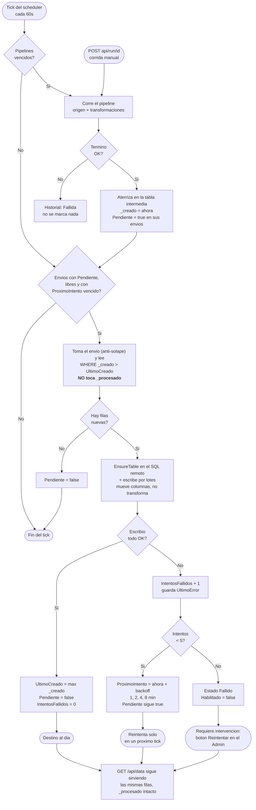

# Envio a SQL externo (push desde pipeline) — diseño previo

> **TAREA:** 00038 · **Fecha:** 12/09/2026 · **Repo:** `D:\Sistemas\MiddleWare` (DataPipeline)
> **Estado:** **implementado** el 17/09/2026. El plan está en
> `docs/superpowers/plans/2026-09-12-datapipeline-envio-sql.md`.
>
> Este documento se actualizó al terminar, con tres cosas que el diseño original no cubría y se
> resolvieron al construir: qué columnas de control viajan al destino (§3), de dónde salen los tipos
> SQL (§3) y el paginado por keyset del cursor (§3). Los nombres definitivos están en §6.

---

## 1. Qué es

Hoy DataPipeline entrega por **PULL**: el pipeline aterriza en su tabla interna y el consumidor
hace `GET /api/data/{nombre}`. Falta la contracara, la **Fase 5** del roadmap: que el middleware
**empuje** por su cuenta.

Lo documentado en `ANALISIS-MIDDLEWARE.md:467` decía "sink REST que hace POST/PUT". **Esto no es
eso.** El destino real es **otra base SQL Server, en otro servidor**: mismo concepto de entrega,
transporte ADO.NET en vez de HTTP.

### Las cuatro decisiones que fijan el alcance

| # | Decisión | Por qué |
|---|---|---|
| **1** | **La tabla destino es nuestra, alojada en el servidor de ellos.** DataPipeline la crea y la mantiene; el otro sistema la lee. | Evita mapeo de columnas, upsert por clave ajena, tipos y constraints de terceros, y una pantalla de mapeo. Costo: pide `CREATE TABLE` en esa base. |
| **2** | **El push mueve columnas. No transforma.** Sin rename, sin cast, sin filtro, sin NCalc. | Todo eso ya lo hace `ColumnMapTransform` **en el pipeline**. Un solo lugar donde mirar cuando algo no cuadra: lo que hay en la tabla intermedia es lo que llega al destino. |
| **3** | **Etapa de entrega separada**, no un destino adicional del runner ni un reemplazo de la tabla interna. | Conserva el desacople extracción/entrega de la sección 13 del análisis. PULL y PUSH conviven. Un destino caído **no** voltea la extracción. |
| **4** | **El envío no tiene reloj: tiene dueño.** Se dispara por bandera cuando su pipeline termina bien. | `TipoProgramacion` no tiene "cada N minutos", y agregarlo sería más caro. Además dos horarios desincronizados son una fuente de bugs que no hace falta abrir. |

### Lo que NO es

- **No es el encadenamiento** del borrador `_borrador-encadenamiento.md`. Eso es **pull múltiple**:
  N pipelines que cargan como una unidad coherente, con visibilidad atómica y apareo de tandas.
  Esto es **una entrega colgada de un pull**. Comparten el mecanismo de disparo, no el problema.
- **No es `SqlServerDataStore`** (Fase 4). Eso sería poner *nuestro* almacén B en SQL Server en vez
  de SQLite. Acá se escribe en la base de un tercero.
- **No hay mapeo de columnas.** Si mañana dos destinos quieren formas distintas del mismo dato,
  son dos pipelines con dos tablas, no un push con dos mapeos.

---

## 2. Circuito

Flujograma en `00-flujograma.png` (para mostrar). El Mermaid de abajo es el que vale al implementar.

### El disparo, en una línea

**El pipeline no ejecuta el envío: sólo dice "hay algo para vos".** Quien ejecuta es siempre el
mismo tick de 60s de `PipelineSchedulerHostedService`. Eso hace que **el disparo y el reintento
sean la misma operación**, invocada por la misma condición (`Pendiente = true`), y no dos caminos
que haya que mantener sincronizados.

---

## 3. Modelo de datos

### Entidad `Envio` (almacén A)

Tabla nueva, creada en `MetadataSchemaInitializer.cs`. **No** migración EF: en este repo las
migraciones ya no se aplican y el DDL idempotente a mano es la fuente de verdad en runtime.

| Campo | Tipo | Para qué |
|---|---|---|
| `Id` | Guid | |
| `Nombre` | string | Identificación en la grilla |
| `Habilitado` | bool | Deshabilitado, el pipeline corre pero no se empuja nada |
| `PipelineId` | Guid | **El dueño.** De él hereda la cadencia |
| `DataSourceId` | Guid | Conexión al SQL remoto (`DataSource` de tipo `SqlServer`) |
| `TablaDestino` | string | Nombre de la tabla allá |
| `Pendiente` | bool | Bandera del disparo |
| `InicioEnCurso` | DateTime? | Anti-solape. `null` = libre |
| `UltimoCreado` | DateTime? | **El cursor**: hasta dónde empujó |
| `IntentosFallidos` | int | Tope de reintentos |
| `ProximoIntento` | DateTime? | Backoff |
| `UltimoEnvio` | DateTime? | Para la grilla |
| `UltimoError` | string? | Para la grilla |

### Reuso de `DataSource`

La conexión remota **es un `DataSource` de tipo `SqlServer`**: ya trae connection string
encriptada, `Activo`, y el `ConnectionTester` para el botón "Probar conexión".

> **Deuda de nombre, asumida a conciencia.** La entidad se llama "origen" y acá se usa de destino.
> Renombrarla a "Conexión" toca media app y no lo vale hoy. Queda anotado para que nadie lo
> descubra de nuevo dentro de seis meses.

### El cursor: por qué `_creado` alcanza

`SqliteDataStore` escribe `_creado = DateTime.Now` en cada lote (`SqliteDataStore.cs:94`) **y lo
refresca en el upsert** (`Creado = excluded.Creado`, línea 78). O sea: `_creado` no es "cuándo
nació la fila" sino **"cuándo se escribió por última vez"**. Eso es exactamente un cursor de
cambios, y ya está en la tabla.

⇒ El envío lee `WHERE _creado > UltimoCreado` y al terminar bien guarda el máximo.

| Consecuencia | Detalle |
|---|---|
| Funciona en los dos modos | `Agregar` (append) y `Reemplazar` (upsert) por igual |
| Una fila modificada vuelve a viajar sola | Su `_creado` se movió, entra en el próximo barrido |
| **No toca `_procesado`** | El push es un consumidor más, con su propia memoria. No le pisa las filas a ningún consumidor PULL |

Esto **esquiva** la limitación del ack global (`_procesado` sin identidad de consumidor) en vez de
agravarla. Es la misma limitación anotada en `_borrador-encadenamiento.md`.

**Guarda de correctitud:** el cursor avanza **sólo al final del envío completo**, nunca por lote.

Y entre lotes se avanza **por keyset** (`(_creado, _key) > última fila leída`), no por `OFFSET`. El
motivo se encontró al implementar: `POST /api/run/{id}` corre en un hilo de request, en paralelo con
el tick del scheduler. Si esa corrida manual reescribe en `Reemplazar` una fila que el envío ya pasó,
la fila salta al final del orden (su `_creado` se refresca) y **todas las posiciones siguientes se
corren un lugar**; con `OFFSET`, la fila que cae en el hueco no se lee nunca y el cursor avanza igual.
Pérdida silenciosa de datos. Reproducido contra SQLite antes del fix; hay test de regresión.

### Qué columnas viajan al destino

La tabla remota lleva **las columnas de negocio + `_key` + `_creado`**.

| Columna | Por qué |
|---|---|
| `_key` | Es la clave del upsert (PK de la tabla remota) |
| `_creado` | Es **cómo el otro sistema sabe qué es nuevo**: "leé lo que tenga `_creado` mayor a tu última lectura" |
| `_procesado` | **No viaja.** Es el ack de *nuestros* consumidores PULL; del otro lado no significa nada |

`_creado` se convierte a `DateTime` antes de mandarlo: SQLite lo devuelve como texto, y mandarlo
crudo dejaría la conversión a `DATETIME2` en manos de la cultura del servidor remoto.

### De dónde salen los tipos SQL

`EnsureTable` necesita tipos y el pipeline no los declara. Se toma **el primer valor no nulo de cada
columna en el primer lote** y se mapea CLR → SQL (`int/long → BIGINT`, `decimal → DECIMAL(38,10)`,
`double → FLOAT`, `bool → BIT`, `DateTime → DATETIME2`, `Guid → UNIQUEIDENTIFIER`, resto
`NVARCHAR(MAX)`). Se eligen tipos anchos a propósito: la tabla es nuestra y no vale la pena afinar.

> **Limitación conocida:** el tipo queda fijado en la primera corrida. Si después cambia el `cast` del
> pipeline, la tabla remota hay que borrarla a mano.

### Historial

Se reusa `PipelineRun` tal cual (ya tiene `FilasEscritas`, `FilasError`, `Mensaje` y los tres
estados), con un **`EnvioId` nullable** que distingue la corrida de envío de la de pipeline.
**Una sola tabla de historial, no dos.**

Lo que esto habilita, y hoy no se puede expresar: **"el pipeline extrajo bien y el envío no pudo
entregar"**.

---

## 4. Reglas

1. **El push no transforma.** Si hace falta renombrar, castear o filtrar, es un
   `ColumnMapTransform` en el pipeline. Sin excepciones: la primera excepción convierte esto en un
   motor de mapeos que nadie pidió.
2. **El envío no tiene programación propia.** No hay campo de horario en la pantalla. Para cambiar
   la frecuencia, se cambia la del pipeline.
3. **Un envío nunca corre solapado consigo mismo.** `InicioEnCurso` se toma con un `UPDATE`
   condicional, no con un `SELECT` + `UPDATE`.
4. **Reintentos: tope de 5 fallos totales**, con esperas de 1, 2, 4 y 8 min entre medio. Al quinto
   fallo, `Habilitado = false` y estado `Fallido`: deja de reintentar solo y pide intervención desde
   el Admin. Son cuatro esperas y no cinco porque el quinto intento ya no reprograma nada.
5. **Una falla de envío nunca voltea la extracción.** Las filas quedan en la tabla intermedia y
   siguen disponibles por `GET /api/data`.
6. **El envío no borra ni marca nada en la tabla intermedia.** Sólo lee.
7. **Permisos requeridos en el servidor remoto:** `CREATE TABLE` (primera corrida) + `INSERT`/
   `UPDATE`. Si el DBA del otro lado no da `CREATE TABLE`, esta decisión se cae y hay que rediseñar
   hacia "la tabla es de ellos" (ver sección 7).

---

## 5. Pantallas

Las maquetas son la referencia de lo que hay que construir. **No rediseñar ni agregar campos que
no estén en ellas.**

| Archivo | Pantalla | Qué muestra |
|---|---|---|
| `01-envios-lista.png` | `/envios` | Grilla con los cinco estados: Al día, Pendiente, Reintentando *n*/5, Fallido, Deshabilitado. Columna de último error. Botón "Reintentar" sólo en los fallidos |
| `02-envios-vacio.png` | `/envios` (vacío) | Estado vacío con la explicación de qué es un envío y qué hace falta antes de crear uno |
| `03-envio-form.png` | `/envios/editar/{id}` | Alta/edición: nombre, pipeline, conexión destino + probar, tabla destino, habilitado. Panel de estado de sólo lectura con el cursor. Aviso de "mueve columnas, no transforma" |
| `04-envio-form-error.png` | `/envios/editar/{id}` (error) | Fallo de "probar conexión" con el error real de SQL Server, validación de tabla destino obligatoria, y el panel de estado en modo fallido con las filas esperando |
| `05-corridas.png` | `/runs` | Historial mezclado con la columna Tipo (Pipeline/Envío) y los filtros. Se lee de corrido "extrajo bien, no entregó" |

`NavMenu.razor` gana una entrada **Envíos** entre Pipelines y Corridas.

---

## 6. Lo construido

Por capa, de adentro hacia afuera. Nombres definitivos, tal como quedaron.

| Capa | Qué |
|---|---|
| `Core` | `Envios/Envio.cs` (entidad + `EstadoEnvio` derivado + `MaxIntentos`), `IEnvioStore`, `IDestinoDatos` + `ColumnaDestino`, `IDestinoFactory`, `EnvioId` en `PipelineRun`, `IHistorialCorridas.IniciarEnvioAsync`, `IDataStore.LeerDesdeAsync(tabla, creadoDesde, keyDesde, limite)` |
| `Persistence` | DDL de `Envios` + `ALTER` de `Corridas` en `MetadataSchemaInitializer`, mapping en `MetadataDbContext`, `EfEnvioStore` (lecturas sin tracking, toma anti-solape con `ExecuteUpdateAsync` condicional) |
| `Connectors` | `Destinos/SqlServerDestinoSql` (armado de SQL **puro**, testeable sin servidor), `Destinos/SqlServerDestino` (ADO.NET), `Destinos/DestinoFactory`, keyset en `SqliteDataStore.LeerDesdeAsync` |
| `Engine` | `BackoffEnvios` (política pura), `EjecutorEnvios` (barrido completo), `EjecutorProgramado` prende `Pendiente` |
| `Api` | `EnviosController` (CRUD + `POST /api/envios/{id}/reintentar`), **rol admin**, el tick corre el barrido, la corrida manual prende la bandera |
| `Admin` | `EnviosAdminService`, `/envios`, `/envios/nuevo`, `/envios/editar/{id}`, columna Tipo y filtros en `/runs`, entrada en `NavMenu` |

**El destino no es un `IDataStore`, a propósito:** `IDataStore` asume `_key`/`_creado`/`_procesado` y
tiene lectura y ack. Un destino externo sólo se escribe. Se llamó `IDestinoDatos` (el diseño lo dejaba
abierto como `IDestinoSql`).

**Rol admin en `/api/envios`:** las rutas de gestión existentes ya lo exigían y esta se había pensado
sin él. Sin el rol, el usuario **pull** —el consumidor externo— podía crear envíos apuntados a
cualquier servidor SQL usando las credenciales ya guardadas en los orígenes. Hay test de los dos
lados: con el rol da 403, sin el rol daba 200.

**Restricciones del repo a respetar:** identificadores técnicos en inglés, propiedades de dominio en
castellano sin tildes ni ñ; commits directos a `main`; gate de 0 warnings
(`dotnet build --no-incremental`); el Admin es build-only, sin tests de UI.

---

## 7. Decisiones diferidas y riesgos

| # | Qué | Estado |
|---|---|---|
| 1 | **`CREATE TABLE` en la base remota.** Si el DBA no lo da, la decisión 1 se cae. | **A verificar antes de empezar a codear.** Es el único riesgo que puede invalidar el diseño entero |
| 2 | **Destino con esquema ajeno** (la tabla es de ellos). Costaría ~50-60% más: abstracción sin DDL, upsert por clave compuesta real, política de filas rechazadas y una pantalla de mapeo. El rename seguiría resolviéndose en el pull. | Diferido. El diseño no le cierra la puerta: el destino es concepto de primera clase, igual que el molde con el que se agregaron Csv/Xlsx |
| 3 | **Destino no-SQL Server** (Postgres, REST). | Diferido. `IDestinoSql` + una rama en la factory, mismo molde |
| 4 | **Si mañana se implementa el grupo de pipelines** del borrador de encadenamiento, el disparo del envío debe colgarse **del cierre del grupo, no de cada miembro**. De lo contrario se empuja una tanda coja | **Anotado acá para que esa tarea lo encuentre** |
| 5 | **Ack global** (`_procesado` sin identidad de consumidor). Este diseño lo esquiva pero no lo arregla. Sigue siendo deuda | Fuera de alcance |
| 6 | **Deuda de nombre:** `DataSource` usado como destino | Fuera de alcance |
| 7 | **El tipo de cada columna queda fijado en la primera corrida** (ver §3). Cambiar el `cast` del pipeline después obliga a borrar la tabla remota a mano | Asumido |
| 8 | **La escritura real contra un SQL Server no se probó en vivo:** no hay servidor en el entorno de desarrollo. El armado del SQL está testeado puro y `SqlServerDestino` es una cáscara fina, pero la ruta completa hay que probarla antes de producción (mismo criterio que TAREA 00026) | **Pendiente antes de producción** |
| 9 | **"Filas esperando"** en el formulario no tiene endpoint que lo calcule: muestra `—` | Anotado, no se inventó superficie nueva |

---

## 8. Referencias al código actual

| Qué | Dónde |
|---|---|
| Scheduler (tick de 60s) | `DataPipeline.Api/Hosting/PipelineSchedulerHostedService.cs:38` |
| Ejecutor de vencidos | `DataPipeline.Engine/EjecutorProgramado.cs:25-56` — el enganche de `Pendiente` va tras el `CompletarAsync` con `Success` |
| Tipos de programación | `DataPipeline.Core/Pipelines/Enums.cs` — **no** tiene "cada N minutos" |
| Corrida manual | `DataPipeline.Api/Controllers/RunsController.cs:30-44` |
| Store interno + columnas de control | `DataPipeline.Connectors/Stores/SqliteDataStore.cs` — `_creado` en :94, refresco en el upsert en :78 |
| Servido PULL | `DataPipeline.Api/Controllers/DataController.cs` |
| Transform (rename/cast/filter) | `DataPipeline.Connectors/Transforms/ColumnMapTransform.cs` |
| Conexión + probar | `DataPipeline.Core/DataSources/DataSource.cs`, `DataPipeline.Connectors/Testing/ConnectionTester.cs` |
| Esquema de metadata | `DataPipeline.Persistence/MetadataSchemaInitializer.cs` — fuente de verdad en runtime |
| Historial | `DataPipeline.Core/Pipelines/PipelineRun.cs` |
