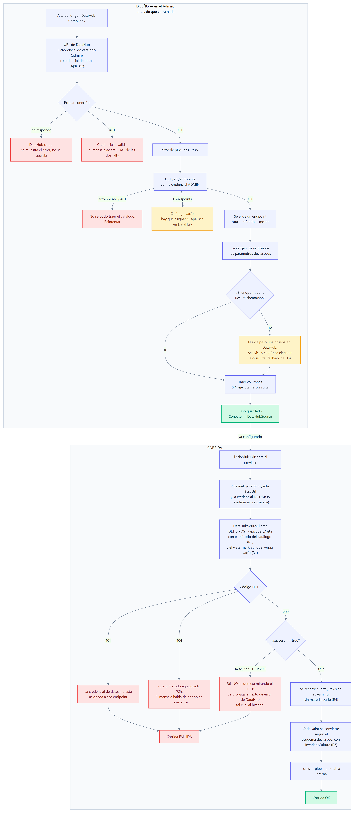
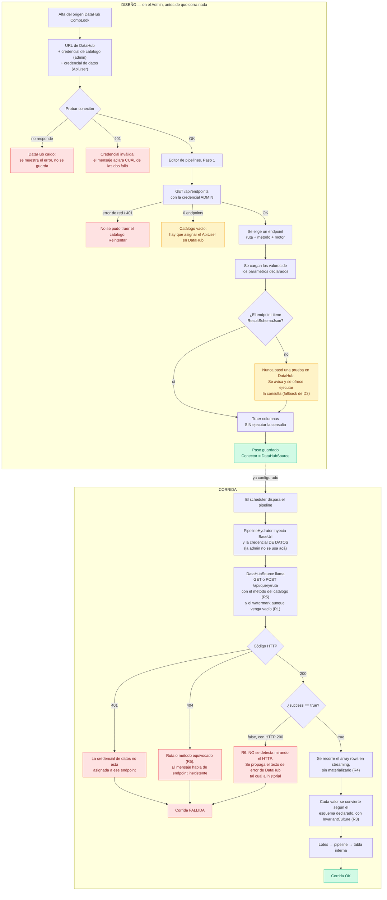

# Origen DataHub CompLook — diseño previo

> **TAREA:** 00152 · **Fecha:** 30/10/2026 · **Repo:** `D:\Sistemas\MiddleWare` (DataPipeline)
> **Estado:** diseño, **sin implementar**.
>
> El pedido original era "traer a DataPipeline todos los tipos de conexión de DataHub, con foco en
> Oracle". Durante el diseño el pedido cambió: en vez de portar los drivers, **DataPipeline consume
> la API de DataHub como origen**. Esta guía documenta ese camino.

---

## 1. Qué es

DataPipeline lee hoy de tres lugares: **SQL Server**, **CSV** y **Excel**. Hace falta **Oracle**,
porque hay casos reales para probar.

DataHub (`D:\Sistemas\ConsultasGenericas`) ya lee de siete motores y tiene las pantallas para
administrarlos. En vez de copiar esos siete ejecutores a DataPipeline, se agrega **un** conector que
habla con la API de DataHub. Con ese conector único quedan alcanzados todos los motores que DataHub
soporta hoy y los que agregue mañana:

| `DataSourceType` de DataHub | Alcanzado |
|---|---|
| Oracle | sí — es el motivo del pedido |
| MySQL · MariaDB · PostgreSQL | sí, de arrastre |
| SQL Server | sí, aunque DataPipeline ya lo tiene directo |
| Excel · RestApi | sí técnicamente, pero ver *Lo que NO es* |

### Por qué no se portan los drivers

| Obstáculo | Detalle |
|---|---|
| **Los contratos son incompatibles** | DataPipeline lee en streaming: `ISource.ReadAsync` devuelve `IAsyncEnumerable<RecordBatch>` y nunca materializa el resultado. DataHub materializa: `IQueryExecutor.ExecuteAsync` devuelve un `QueryResultDto` con todas las filas adentro. No son adaptables uno al otro: hay que reescribir, no copiar. |
| **Es siete veces el trabajo** | Un ejecutor por motor, más la adaptación de parámetros de cada uno (Oracle usa `:p` y no `@p`), más la expansión de listas IN, más las pruebas. |
| **Y después hay que administrarlo** | Cadena de conexión por motor, encriptación, prueba de conexión, descubrimiento de columnas y pantallas. DataHub ya tiene todo eso funcionando. |

### El costo de ir por la API

Tres cosas, y conviene tenerlas a la vista antes de empezar:

1. **DataHub materializa el resultado completo antes de responder.** Un endpoint de 250 mil filas se
   arma entero en memoria del lado de DataHub. DataPipeline puede leer la respuesta en streaming
   (regla **R4**), pero eso no cambia lo que pasa del otro lado.
2. **Los tipos se achatan al pasar por JSON.** Una fecha de Oracle llega como texto. Esto pega
   directo en la decisión **D2** de la TAREA 00038, donde el tipo de la columna destino se infiere
   del primer lote. Se resuelve con la regla **R3**.
3. **DataHub pasa a ser una pieza obligatoria de la cadena.** Si DataHub está caído, el pipeline
   falla aunque la base Oracle esté perfecta. Hoy la cadena es *origen → DataPipeline*; con esto es
   *origen → DataHub → DataPipeline*.

### Lo que NO es

- **No es un conector REST genérico.** Por eso el tipo se llama **DataHub CompLook** y no "REST":
  sabe hablar *este* protocolo, con *este* catálogo y *esta* autenticación. Un conector REST
  genérico es otra idea, diferida, y va a ser **otro** tipo distinto en el mismo enum.
- **No reemplaza `SqlServerSource`.** Para SQL Server sigue conviniendo ir directo: streaming real,
  sin JSON en el medio y sin una pieza más en la cadena.
- **No trae el Excel de DataHub.** El `XlsxSource` propio es mejor para pipelines: watermark por
  archivo, patrón de nombre y carpeta `\procesados`. El de DataHub lee un archivo fijo.
- **No toca DataHub.** Todo el cambio es en DataPipeline. DataHub se consume tal como está.

---

## 2. Ítems del pedido

| Ítem | Qué |
|---|---|
| **1** | **El origen.** `TipoDataSource.DataHubCompLook`, el conector `DataHubSource` en streaming, el caso en `SourceFactory` y la rama en `PipelineHydrator`. Incluye la convención de watermark. |
| **2** | **El catálogo de endpoints.** DataPipeline trae de DataHub la lista de endpoints y se elige uno; los parámetros que ese endpoint declara se cargan con sus nombres y tipos. |
| **3** | **Probar conexión y traer columnas** para el tipo nuevo, con las columnas saliendo del esquema que DataHub ya tiene guardado. |
| **4** | **Admin.** Los campos del origen DataHub CompLook y el Paso 1 del editor de pipelines. |

---

## 3. Cómo se habla con DataHub

### Los dos endpoints que se usan

| Para qué | Llamada | Qué devuelve |
|---|---|---|
| Traer el catálogo | `GET {BaseUrl}/api/endpoints` | La lista completa de endpoints, con todo lo que hace falta para elegir y configurar |
| Traer los datos | `GET` o `POST {BaseUrl}/api/query/{ruta}` | `{ success, columns, rows }` con el resultado entero |

De cada endpoint del catálogo se usan estos campos (`ApiEndpointResponseDto`):

| Campo | Para qué |
|---|---|
| `Route` | La ruta que se le pega a `/api/query/` |
| `HttpMethod` | **`GET` o `POST`: hay que respetarlo.** DataHub busca el endpoint por ruta **y** método; con el método equivocado devuelve 404 (ver **R5**) |
| `Description` | Lo que se muestra en el combo junto a la ruta |
| `DataSourceName` | De qué motor sale. Es lo que permite ver cuáles son los Oracle |
| `IsActive` | Los apagados no se ofrecen |
| `ParameterDefinitions` | `[{ Name, Type, Label, Descripcion, Requerido }]` — **los parámetros declarados** |
| `ResultSchemaJson` | `[{ name, dataType }]` — **el esquema del resultado**, que DataHub graba cuando el endpoint pasa una prueba. Es lo que hace que "Traer columnas" no tenga que ejecutar nada |

`ParameterType` de DataHub es `Text · Number · Date · DateTime`. El `dataType` de `ResultSchemaJson`
es más grueso: `texto · número · fecha · booleano · desconocido`.

### Las dos credenciales, y por qué son dos

No es una elección de diseño: es cómo está hecho DataHub.

| Llamada | Autenticación | Quién pasa |
|---|---|---|
| `GET /api/endpoints` | `[Authorize(Policy = Politicas.Admin)]` | **Sólo `consuAdmin`.** Un `ApiUser` cualquiera obtiene el rol `Usuario`, que no alcanza |
| `/api/query/{ruta}` | `[AutenticacionPropia]` — el controlador valida Basic **a mano** | **Sólo un `ApiUser` asignado a ese endpoint** |

Y lo segundo es más estricto de lo que parece. `QueryController` no mira roles: busca el usuario
dentro de las asignaciones **del endpoint**.

```csharp
var usuarioAsignado = endpoint.UserAssignments
    .Select(a => a.ApiUser)
    .FirstOrDefault(u => u.IsActive && u.Username == usuarioBasic);
```

**`consuAdmin` no pasa por ahí** salvo que esté asignado explícitamente a ese endpoint. O sea: la
credencial que lista los endpoints **no es** la que puede leerlos.

Por eso un origen DataHub CompLook guarda **dos pares de credenciales, los dos obligatorios**: uno
para el catálogo y uno para los datos. Esto está decidido (**D2**) y hay que dar de alta en DataHub
un `ApiUser` para DataPipeline y asignarlo a cada endpoint que se vaya a consumir.

---

## 4. Modelo de datos

### `DataSource` — campos nuevos

El enum crece al final, para no mover los valores que ya están persistidos:

```csharp
public enum TipoDataSource { SqlServer, Csv, Xlsx, DataHubCompLook }
```

| Campo | Uso | Encriptado |
|---|---|---|
| `BaseUrl` | La URL de DataHub, ej. `http://servidor:5000`. **El campo ya existe** (hoy sin uso, comentado como "futuro (RestApi)"): se estrena acá | no |
| `Username` / `Password` | El **`ApiUser` asignado** — el que trae los datos | sí |
| `UsuarioCatalogo` / `PasswordCatalogo` | **Nuevos.** La credencial admin, sólo para `GET /api/endpoints` | sí |

Los cuatro campos son obligatorios para este tipo. Los campos de archivo (`RutaCarpeta`,
`Separador`, `HojaExcel`, …) y `ConnectionString` no se usan.

Como no hay migraciones de EF, las dos columnas nuevas van en `MetadataSchemaInitializer`.

### Config del paso Origen

El `Conector` del paso es `"DataHubSource"`. La configuración que deja el Admin:

| Clave | Qué |
|---|---|
| `dataSourceId` | El origen DataHub, como en todos los tipos |
| `ruta` | La `Route` del endpoint elegido |
| `metodoHttp` | `GET` o `POST`, copiado del catálogo |
| `parametros` | Los valores fijos de los parámetros, `{ "nombre": "valor" }` |
| `esquema` | El `ResultSchemaJson` del endpoint, tal como vino. Es lo que usa la regla **R3** en corrida |

`PipelineHydrator` agrega en corrida `baseUrl`, `usuario` y `password` desencriptados (la credencial
de **datos**; la del catálogo no se usa en corrida).

---

## 5. Reglas

**R1 — Se mandan exactamente los parámetros que el endpoint declara: ni uno menos, ni uno de más.**

> Corregida al implementar (31/10/2026). La versión original decía "el watermark se manda siempre".
> Es media verdad y la otra media rompe: `ArmarParametros` de DataHub mete en el comando **todos**
> los parámetros que recibe, estén o no en el SQL (`SqlQueryExecutorBase.cs:121`). Un parámetro de
> más hace fallar la consulta — en Oracle con un `ORA-01036` que no orienta a nada.

- **Ni uno menos:** si el endpoint declara `watermark` y no se manda, Dapper no lo declara y el SQL
  que lo menciona falla. Por eso, si está declarado, se manda **siempre**, vacío en la primera corrida.
- **Ni uno de más:** nunca se manda un parámetro que el endpoint no declare, aunque venga en el
  contexto de la corrida.

Lo que resuelve las dos mitades: el paso guarda los nombres **declarados** por el endpoint, y en
corrida cada uno toma su valor del contexto si está, o el valor fijo si no.

Y **vacío no es NULL**: todos los parámetros llegan como texto, así que el `WHERE @watermark IS NULL
OR …` de siempre no alcanza. El SQL del endpoint tiene que tratar el vacío como "primera corrida":

```sql
WHERE :watermark IS NULL OR :watermark = '' OR fecha_mod > …
```

**R2 — A Oracle los parámetros llegan como texto.** Comparar contra una columna `DATE` necesita
conversión explícita en el SQL del endpoint:

```sql
AND fecha_mod > TO_DATE(:watermark, 'YYYY-MM-DD HH24:MI:SS')
```

R1 y R2 son del lado de DataHub: las cumple quien escribe el SQL del endpoint. El Admin las muestra
como ayuda al configurar el paso, igual que hoy muestra la de `@watermark` para SQL Server.

**R3 — Los valores se convierten según el esquema declarado, con `InvariantCulture`.**
Las filas llegan como JSON: una fecha de Oracle es un string. Convertir con el formato de la máquina
rompe según la cultura — es el mismo error que ya se corrigió en el commit `598464c` y otra vez en la
TAREA 00038. Se usa el `dataType` de `esquema` para decidir el tipo, y siempre
`CultureInfo.InvariantCulture`. Una columna `desconocido` o que no esté en el esquema queda como
texto, sin adivinar.

**R4 — La respuesta se lee en streaming.** El array `rows` se recorre con `Utf8JsonReader` sobre el
stream de la respuesta (`HttpCompletionOption.ResponseHeadersRead`), emitiendo un `Record` por
elemento y sin tener nunca el array completo en memoria. DataPipeline no agrega una segunda copia de
lo que DataHub ya materializó.

**R5 — El método HTTP sale del catálogo, no se elige.** DataHub busca el endpoint por `Route` **y**
`HttpMethod`; con el método equivocado la respuesta es 404 y el mensaje habla de endpoint
inexistente, que manda a buscar el problema al lugar equivocado. En `GET` los parámetros van por
query string; en `POST` van en el body como `{ "parameters": { … } }`.

**R6 — Un error de DataHub es una corrida fallida, con el texto de DataHub.** `QueryResultDto` trae
`success: false` y `error` con HTTP 200 en varios casos, así que **no alcanza con mirar el código
HTTP**: hay que mirar `success`. El texto de `error` se propaga tal cual al historial de corridas, sin
reemplazarlo por un mensaje genérico.

**R7 — Los secretos nunca viajan por la URL.** Las credenciales van en el header `Authorization`.
En los parámetros por query string van sólo filtros de negocio y el watermark.

**R8 — Los tres `if` binarios se vuelven `switch`.** Hay tres lugares escritos para dos familias
(SQL Server / archivo) donde un tercer tipo entra por la rama equivocada **en silencio**:

| Dónde | Qué pasa hoy con un tipo nuevo |
|---|---|
| `DataPipeline.Api/Controllers/DataSourcesController.cs:102` (`Probar`) | `if (d.Tipo != TipoDataSource.SqlServer)` → lo prueba como carpeta de archivos |
| `DataPipeline.Api/Controllers/DataSourcesController.cs:119` (`Columnas`) | idem: le busca el encabezado a un archivo que no existe |
| `DataPipeline.Engine/PipelineHydrator.cs:39` | `if (ds.Tipo == TipoDataSource.SqlServer) … else` archivo → le inyecta `rutaCarpeta` |
| `DataPipeline.Admin/…/Pipelines/Editor.razor:378` y `:434` | `EsOrigenDeArchivo is 1 or 2` y `_ => "SqlServerSource"`: el tipo nuevo cae en el `_` y **el paso se guarda como `SqlServerSource`** |

El último es el peor: no falla al guardar, falla al correr, con un error de conexión que no tiene
nada que ver. Los cuatro pasan a ser `switch` exhaustivos sobre `TipoDataSource`.

---

## 6. Decisiones

| # | Decisión | Por qué |
|---|---|---|
| **D1** | **El parseo es en streaming** (`Utf8JsonReader`), no `JsonDocument`. | Es la única pieza de código realmente nueva (~80 líneas, testeables con un JSON armado a mano). La alternativa, deserializar el `QueryResultDto` completo, duplica en DataPipeline la memoria que DataHub ya gastó. Con 250 mil filas eso se nota. |
| **D2** | **Dos credenciales, las dos obligatorias.** | No es elegible: `GET /api/endpoints` pide rol Admin y `/api/query` pide un `ApiUser` asignado al endpoint. El catálogo no es opcional, así que la credencial admin tampoco. Consecuencia operativa: hay que crear un `ApiUser` para DataPipeline en DataHub y asignarlo a cada endpoint a consumir. |
| **D3** | **Las columnas salen de `ResultSchemaJson`.** | DataHub ya guardó el esquema cuando el endpoint pasó una prueba. Traer columnas no ejecuta la consulta: ni espera, ni carga Oracle, ni pide el parámetro obligatorio. **Fallback:** si el endpoint nunca pasó una prueba, `ResultSchemaJson` viene vacío; ahí el Admin avisa que hay que probar el endpoint en DataHub, y ofrece ejecutar la consulta como segunda opción. |
| **D4** | **El tipo se llama `DataHubCompLook`.** | Deja libre el nombre para un conector REST genérico, que es otra idea y otro tipo. El enum crece **al final**, pero no por la base: `Tipo` se persiste **por nombre** (`HasConversion<string>` en `MetadataDbContext`), así que insertar en el medio no rompería `metadata.db`. Lo que sí rompe es el Admin, que mapea el combo **por índice** (`0=SqlServer, 1=Csv, 2=Xlsx`). *(Precisión corregida al implementar: la versión original decía que los valores 0-2 estaban guardados en la base.)* |
| **D5** | **Sin mapeo de columnas ni transformación en el origen.** | Lo que el endpoint devuelve es lo que entra al pipeline. Renombrar y castear ya lo hace `ColumnMapTransform`, igual que en la TAREA 00038. |

---

## 7. Orden de implementación

| Paso | Ítem | Qué | Cómo se verifica |
|---|---|---|---|
| 1 | 1 | `TipoDataSource.DataHubCompLook` + los dos campos nuevos en `DataSource` + `MetadataSchemaInitializer` | Prueba de esquema: las columnas existen y un `DataSource` del tipo nuevo va y vuelve de la base |
| 2 | 1 | `DataHubSource` con el parseo en streaming (**R3**, **R4**, **R6**) | Pruebas con un `HttpMessageHandler` falso: resultado normal, resultado vacío, `success: false`, fechas en texto, columna fuera del esquema |
| 3 | 1 | `SourceFactory` + `PipelineHydrator` (**R8** en el hydrator) | Prueba de que el paso resuelve a `DataHubSource` y de que el hydrator inyecta `baseUrl`/credenciales y **no** `rutaCarpeta` |
| 4 | 2 | Cliente del catálogo: `IDataHubCatalogo` + `GET /api/endpoints` con la credencial admin | Pruebas de que filtra los inactivos y de que un 401 da un mensaje claro |
| 5 | 3 | `IConnectionTester.ProbarDataHubAsync` e `ISchemaDiscoverer.DescubrirDataHubAsync` (**D3**) + el `switch` de `DataSourcesController` (**R8**) | Probar conexión contra DataHub caído, con credencial mala y OK; columnas con y sin `ResultSchemaJson` |
| 6 | 2, 4 | Admin: los campos del origen, el combo de endpoints, el editor de parámetros y el `switch` de `Editor.razor` (**R8**) | Según las maquetas de §9 |

Cada bloque lleva su comentario `Fecha: dd/MM/yyyy - TAREA: 00152 - Linea: N - …` con el ítem que lo
originó.

---

## 8. Flujograma





---

## 9. Maquetas

| Archivo | Qué muestra |
|---|---|
| `01-origen-datahub.png` | El diálogo *Nuevo origen* con el tipo **DataHub CompLook**: URL, las dos credenciales con su etiqueta de para qué sirve cada una, y el botón Probar en verde |
| `01-origen-datahub-error.png` | El mismo diálogo después de un Probar fallido, con el texto de DataHub |
| `02-paso1-endpoints.png` | Paso 1 del editor: el combo de endpoints mostrando ruta, descripción y motor, y debajo los parámetros declarados con sus etiquetas y el watermark marcado |
| `02-paso1-endpoints-vacio.png` | El catálogo trajo cero endpoints asignables |
| `02-paso1-endpoints-error.png` | El catálogo no se pudo traer (DataHub caído o credencial admin inválida) |
| `03-columnas-esquema.png` | Las columnas traídas del esquema guardado, con nombre y tipo, y la ayuda de **R1**/**R2** sobre el watermark |
| `03-columnas-esquema-sin-esquema.png` | El endpoint nunca pasó una prueba en DataHub: el aviso y la opción de ejecutar la consulta (fallback de **D3**) |

---

## 10. Lo que queda pendiente de confirmar

- **Un `ApiUser` para DataPipeline en DataHub**, asignado a cada endpoint a consumir, y la credencial
  admin para el catálogo (**D2**). Sin esto no se puede probar nada de punta a punta.
- **Al menos un endpoint Oracle con prueba exitosa** en DataHub, para que `ResultSchemaJson` exista y
  **D3** funcione.
- **Un endpoint Oracle con `watermark`** que cumpla **R1** y **R2**, para probar la carga incremental.
  Si los endpoints existentes no lo tienen, la primera prueba va a ser carga completa.
