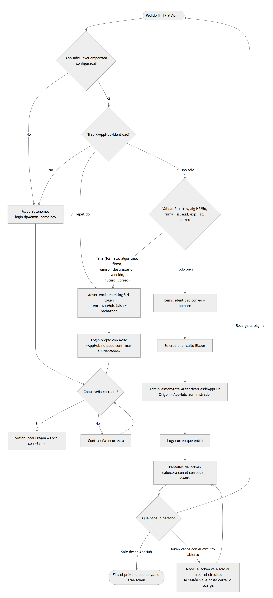
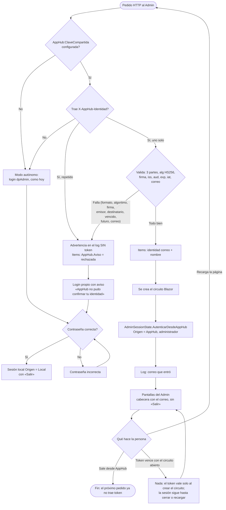

# TAREA 00157 — DataPipeline.Admin dentro de AppHub (identidad)

Fecha: 02/11/2026 · Estado: guía aprobada · flujograma y maquetas pendientes de aprobación · Basada en el contrato
`D:\Sistemas\Concentrador\Docs\Contrato-Apps.md` (v0.2) y en el piloto del Conciliador (TAREA 00140).

## 1. Qué es

AppHub (portal con ingreso por Microsoft) deja abrir DataPipeline.Admin sin que pida su
usuario y contraseña. AppHub manda un token firmado en el encabezado `X-AppHub-Identidad`;
el Admin lo valida y abre la sesión. Sin la clave compartida el Admin funciona **igual que
hoy** (modo autónomo, login `dpAdmin`).

Alcance: **solo DataPipeline.Admin**. `DataPipeline.Api` no cambia: el Admin le sigue
hablando con Basic, desde el servidor.

## 2. Ítems del pedido

Pedido textual: «modificar el proyecto D:\Sistemas\MiddleWare para que se integre con
AppHub… mismo trabajo que se hizo en Conciliador». Numeración (confirmada: «igual que
Conciliador»):

| Ítem | Qué |
|---|---|
| 1 | Sección `AppHub` en la config y validación del token `X-AppHub-Identidad` (HS256, `iss`, `aud`, vencimiento, correo). |
| 2 | Usuario de AppHub: quien llega con token válido entra **como administrador** (ver §4, decisión 1). |
| 3 | Sesión: entra sin login; con sesión de AppHub no se muestra «Salir»; el login propio queda como respaldo con el aviso «AppHub no pudo confirmar tu identidad». |
| 4 | Correr detrás de AppHub: `PathBase` (`/datapipeline`), sin redirección a https, cookies/websocket de Blazor; guía de despliegue. |

## 3. Cómo funciona el Admin hoy (lo que condiciona el diseño)

- Un único usuario fijo `dpAdmin`; contraseña BCrypt en `admin-credentials.json`
  (`AdminAuthService`). **No hay tabla de usuarios ni permisos.**
- La sesión es `AdminSessionState`, scoped por **circuito Blazor Server** (memoria; **sin
  cookie**). Una recarga completa pide el login de nuevo.
- `MainLayout` muestra la app solo si `Session.IsAuthenticated`; si no, manda a `/login`.

Consecuencia: el Conciliador abre una cookie desde un middleware; acá no hay cookie y no
conviene inventarla. Una conexión Blazor se crea a partir del **primer pedido HTTP**, que sí
trae el encabezado (AppHub lo agrega en cada pedido); los mensajes posteriores viajan por el
websocket y ya no lo traen.

## 4. Decisiones

1. **Permisos: quien AppHub deja abrir, entra como administrador.** Es una **excepción al
   punto 4 del contrato** («el primer ingreso nunca da permisos»): el Admin es todo-o-nada y
   no tiene dónde guardar permisos. Quien decide el acceso es AppHub (asignación de la app
   `datapipeline` en «Usuarios»). Se registra en el log el correo que entró. *Decidido por
   quien hizo el pedido.*
2. **Sin tabla de usuarios, sin `oid` persistido.** El correo y el nombre del token alcanzan
   para mostrar quién está; no se guarda nada. `AdministradoresIniciales` **no se usa** (no hay
   nada que ascender) y no se agrega a la config de esta app.
3. **Sin cookie.** El middleware valida el token del pedido HTTP y deja la identidad en
   `HttpContext.Items`; al crearse el circuito, `AdminSessionState` la toma y queda
   autenticado (`Origen = AppHub`). Al recargar, el pedido vuelve a traer el token y entra
   solo.
4. **Un token inválido nunca abre sesión.** Se registra una advertencia sin el contenido del
   token, y se muestra el login propio con el aviso.
5. **El login propio no sirve para la sesión de AppHub** y la sesión de AppHub no muestra
   «Salir» (se sale desde AppHub).

## 5. Reglas (del contrato §3–§6, aplicadas)

- Config: `AppHub:Aplicacion` = `datapipeline`; `AppHub:ClaveCompartida` vacía = autónomo;
  mínimo 32 caracteres si se usa; `AppHub:ToleranciaSegundos` (30, entre 0 y 300). Si hay
  clave y falta `Aplicacion`, **no arranca**.
- Token: JWT compacto de tres partes, `alg=HS256` (cualquier otro, incluido `none`, se
  rechaza), firma comparada en tiempo constante, `iss=AppHub`, `aud=AppHub:Aplicacion`,
  `exp` no vencido, `iat` no futuro (con tolerancia), `email` con forma de correo.
- Un solo encabezado: si viene repetido se rechaza.
- Ni el token ni la clave aparecen en el log.
- Un navegador que falsifique el encabezado **sin pasar por AppHub** no abre sesión (la
  firma no coincide).

## 6. Modelo de datos

Ninguno. Sin tablas, sin migraciones. Solo la sección `AppHub` en `appsettings.json` y la
clave real en la config del servidor (no en el repo).

## 7. Archivos previstos

| Archivo | Cambio |
|---|---|
| `DataPipeline.Admin/Services/TokenAppHub.cs` | Nuevo. Opciones + validación del token (portado del Conciliador, mismos motivos de rechazo). |
| `DataPipeline.Admin/Services/IdentidadAppHub.cs` | Nuevo. Middleware: valida y deja la identidad en `HttpContext.Items`. |
| `DataPipeline.Admin/Services/AdminSessionState.cs` | `Origen` (Local/AppHub), `Correo`; `AutenticarDesdeAppHub(...)`. |
| `DataPipeline.Admin/Components/Layout/MainLayout.razor` | Toma la identidad al crear el circuito; oculta «Salir» si `Origen = AppHub`. |
| `DataPipeline.Admin/Components/Pages/Login.razor` | Aviso «AppHub no pudo confirmar tu identidad». |
| `DataPipeline.Admin/Program.cs` | Opciones, middleware, `PathBase`, `ForzarHttps`. |
| `DataPipeline.Admin/appsettings.json` | Sección `AppHub` (clave vacía). |
| `tests/…` | Pruebas del token (los 10 casos del checklist del contrato). |
| `docs/Despliegue-AppHub.md` | Alta en AppHub (`Apps[]`), clave compartida, `PathBase`. |

## 8. Orden de implementación

1. `TokenAppHub` + pruebas (ítem 1).
2. `IdentidadAppHub` + `AdminSessionState` (ítems 2–3).
3. `MainLayout` / `Login` (ítem 3).
4. `Program.cs`: `PathBase`, https, config (ítem 4).
5. Guía de despliegue y verificación en navegador con un AppHub simulado (ítem 4).

## 9. Qué no se puede verificar acá

Contra el AppHub real publicado y su proxy: cómo reenvía el websocket de Blazor
(`/_blazor`) y los estáticos bajo `/datapipeline/`. Se prueba con el encabezado firmado a
mano y, si se puede, con AppHub local; queda anotado en el historial.

## Flujograma

## Maquetas

El Admin no gana pantallas ni campos. Lo único visible que cambia:

- `01-login-aviso.png` — `/login` con el aviso «AppHub no pudo confirmar tu identidad».
- `02-layout-apphub.png` — cabecera con el correo de quien entró por AppHub y **sin** «Salir».
