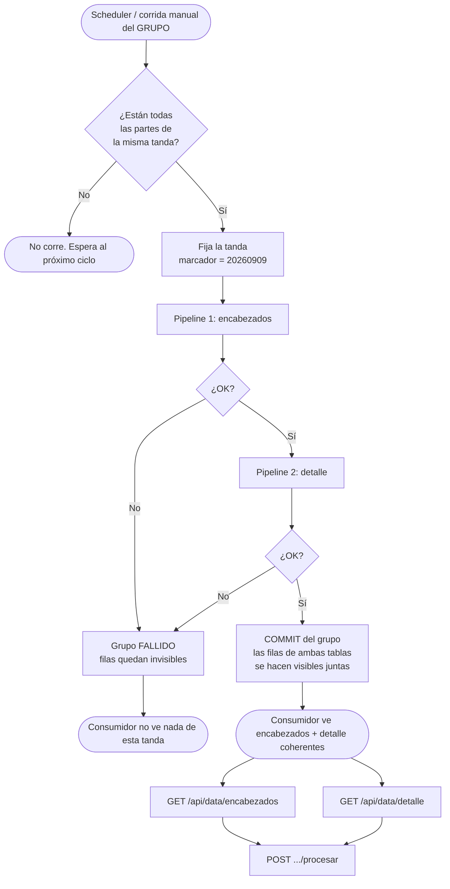

# Encadenamiento de procesos en DataPipeline — material de diseño previo

> **Estado:** BORRADOR. Discusión de diseño, sin código ni plan formal todavía.
> **Fecha de la charla:** 09/09/2026. **Capturado:** 12/09/2026.
> **TAREA:** sin asignar todavía (hay que tomar el siguiente de `~/.claude/TAREAS.md` antes de planificar).
>
> Este archivo existe para no perder lo acordado. Vive suelto en `docs/Diseño/` justamente porque
> todavía no tiene número de TAREA: cuando se le asigne, pasa a
> `docs/Diseño/NNNNN-encadenamiento/encadenamiento.md` y se completa con el flujograma en PNG y las
> maquetas de pantalla que exige la convención de "Diseño previo". Recién después se planifica la
> implementación.

---

## Contexto

La idea es **encadenar procesos y hacer todo el trabajo de punto medio desde DataPipeline**
(MiddleWare), dejando ConsultasGenericas como lo que es.

El disparador concreto: un origen de **comprobantes** con estructura relacional. Son 4 tablas
pero interesan dos:

| Tabla | Clave |
|---|---|
| `encabezado` | `id` |
| `detalle` | `id` propio + `idencabezado` (FK) + `nrolinea` |

Hoy DataPipeline sólo puede modelar eso como **dos pipelines independientes con dos tablas
destino independientes**, sin nada que las ate. Eso rompe la coherencia para el consumidor.

---

## Decisiones tomadas

### 1. Se modifica DataPipeline, no ConsultasGenericas

**ConsultasGenericas no tiene estado, por diseño.** Su `GET/POST /api/query/{*ruta}` re-ejecuta
la query completa y devuelve todo, siempre: no hay paginado, ni cursor, ni "desde X", ni marcado
de consumido. Verificado en los seis executors.

Agregarle eso no sería una mejora: necesitaría almacén propio, identidad de consumidor y tracking
de watermark, o sea, se convertiría en un segundo DataPipeline. El trabajo de punto medio es
literalmente lo que ya hace esta app.

### 2. DataPipeline puede consumir CG sin tocar CG, incluso incrementalmente

El `QueryController` de CG bindea los parámetros que le mande el llamador **directo a Dapper**
contra el SQL del endpoint. Así que `@watermark` pasa a ser una **convención en cómo se escribe
el SQL del endpoint de CG**:

```sql
WHERE @watermark IS NULL OR fecha_mod > @watermark
```

Es exactamente el mismo contrato que `SqlServerSource` ya tiene hoy con el SQL que escribe el
usuario. El campo `DataSource.BaseUrl` ya está reservado para esto (`// futuro (RestApi)`).

### 3. Son dos capacidades independientes, no una

| # | Capacidad | Estado hoy |
|---|---|---|
| **(i)** | **Origen HTTP**: DP consume un endpoint de CG (o cualquier REST) | No existe. Mismo molde que Csv/Xlsx: `TipoDataSource` + `ISource` + caso en `SourceFactory` + rama en `PipelineHydrator` + campos en el Admin |
| **(ii)** | **Encadenar pipelines**: que B corra cuando termina A | No existe. `CorrerDespuesDe` está muerto |

Se pueden hacer en cualquier orden. **Este documento cubre (ii).** La (i) queda diferida, pero el
diseño de (ii) no debe cerrarle la puerta.

### 4. El consumidor quiere las dos tablas separadas

Va a insertar en su propio esquema encabezado/detalle. Eso **descarta** como forma de servido:

- aplanar con JOIN (una fila por línea con el encabezado repetido), y
- anidar las líneas como JSON en la fila del encabezado.

Ambas entraban perfecto en el modelo actual sin tocar el motor, pero no es lo que se necesita.

### 5. Hay que soportar los dos tipos de origen

Algunas instalaciones tienen base o endpoint consultable; otras sólo tiran archivos. O sea: **no
se puede resolver todo arriba en la query**, hace falta capacidad nueva en DataPipeline.

### 6. La coherencia tiene que ser fuerte: o se ve todo, o no se ve nada

**Encadenar no alcanza.** `CorrerDespuesDe` arregla el orden de *carga*, no la *visibilidad*. Un
consumidor que pullea cada N segundos va a caer en la ventana entre que terminó el pipeline de
encabezados y todavía no terminó el de detalle, y se lleva encabezados sin líneas. Con chaining
solo, esa ventana existe siempre: se achica, no se elimina.

Hacen falta **dos piezas**:

1. **Grupo de pipelines** — N pipelines que corren como unidad, en orden declarado. Esto es
   implementar de verdad el `CorrerDespuesDe` que hoy está muerto.
2. **Visibilidad atómica del grupo** — las filas que escribe una corrida del grupo no las ve
   `GET /api/data/...` hasta que *todo* el grupo terminó bien. Si falla el de detalle, el
   encabezado tampoco aparece.

La segunda es más barata de lo que suena: `SqliteDataStore.EnsureTableAsync` ya agrega columnas
de control (`_key`, `_creado`, `_procesado`) y `ReadPagedAsync` ya filtra por `_procesado = 0`.
Un `_visible` que se prende al cerrar el grupo es la misma cañería, en los mismos dos lugares.

### 7. Los archivos de una misma tanda se aparean por un marcador común en el nombre

Ej. `ENCABEZADOS_20260909.csv` + `DETALLE_20260909.csv`. El grupo **no debe correr una tanda
coja**: si sólo llegó una de las dos partes, espera.

Sin esa guarda, el pipeline de encabezados agarra su archivo, el de detalle no encuentra nada, el
grupo cierra "bien" y se hace visible un comprobante sin líneas.

---

## El watermark casi no hace falta en este caso

Era la mayor preocupación y se despeja sola:

- **Archivos:** el archivo *es* la unidad de novedad. DataPipeline ya no relee un archivo nunca
  (se mueve a `\procesados` tras leerlo completo sin error). No se necesita columna watermark.
- **Consulta:** el detalle joinea al encabezado para traerse su `fecha_mod`
  (`WHERE @watermark IS NULL OR e.fecha_mod > @watermark`). Se resuelve en el SQL, sin motor nuevo.

Esto **evita** el problema que tendría watermarkear el detalle por `idencabezado`: se rompe apenas
alguien edita un comprobante viejo (el `fecha_mod` del encabezado se mueve, el `idencabezado` no).

---

## Referencias al código actual (verificado en sesión)

### ConsultasGenericas — `D:\proyectos\consultasgenericas`

| Qué | Dónde |
|---|---|
| Endpoint consumidor | `Api/Controllers/QueryController.cs:24-35` — `GET`/`POST /api/query/{*ruta}`; identifica el endpoint por `Route` + `HttpMethod` + `IsActive` (líneas 47-53) |
| Auth | Basic, `QueryController.cs:62-115`. Contra tabla `EndpointUsers` + BCrypt. **Por endpoint, no global** (`Core/Entities/EndpointUser.cs:7-8`) |
| Parámetros | Query string (GET) o `QueryRequestDto` (POST) → dict plano de strings → Dapper `DynamicParameters` (ej. `SqlServerQueryExecutor.cs:22-26`) |
| Respuesta | `Core/DTOs/QueryResultDto.cs` → `{ Success, Data, Error }`; `Data` = filas dinámicas con tipos nativos de la base |
| Paginado / incremental / ack | **No existe nada.** Ningún page/offset/cursor/since/procesado en toda la app |
| Entidad endpoint | `Core/Entities/ApiEndpoint.cs` — `Route, HttpMethod, DataSourceId, Query, Description, IsActive, EndpointUsers` |

### DataPipeline — `D:\Sistemas\MiddleWare`

| Qué | Dónde | Nota |
|---|---|---|
| `CorrerDespuesDe` | `Core/Pipelines/PipelineDefinition.cs:21` | **Declarado y persistido, leído por NADIE.** Sólo cañería: EF `MetadataDbContext.cs:47`, DDL `MetadataSchemaInitializer.cs:56`. Los docs de Fase 3E lo marcan explícitamente fuera de alcance y lo dejan para Fase 4 |
| Scheduling | `Engine/EjecutorProgramado.cs:25-56`, `Engine/ScheduleCalculator.cs:8-18`, `Persistence/EfPipelineStore.cs:29-32` | Puro reloj. Filtra `Habilitado && ProximaCorrida <= ahora`. `BajoDemanda` ⇒ `null` ⇒ nunca auto-corre. **Sin ninguna noción de dependencia entre pipelines** |
| Hosted service | `Api/Program.cs:38` → `Api/Hosting/PipelineSchedulerHostedService.cs:38` | Poll cada 60s |
| Runner | `Engine/PipelineRunner.cs` | Exige **exactamente un** paso Origen (`SingleOrDefault(...) ?? throw`). **Sin transacción a nivel corrida**: los lotes commitean a medida que van |
| Corrida on-demand | `Api/Controllers/RunsController.cs:30-44` | `POST api/run/{id:guid}`, rol admin. Corre un pipeline y vuelve; no dispara nada más |
| Hydrator | `Engine/PipelineHydrator.cs:39,48,54` | Ramifica por `SqlServer` / `Csv` / `Xlsx`; inyecta connection string o config de carpeta en `StepDefinition.Configuracion` |
| Store destino | `Connectors/Stores/SqliteDataStore.cs` | Columnas de control `_key`, `_creado`, `_procesado` (`EnsureTableAsync:20-52`). `_key` = concatenación de `ColumnasClave` (`CalcularKey:154-160`) |
| — `Reemplazar` | `SqliteDataStore.cs:70-79` | Índice único sobre `_key` + `ON CONFLICT DO UPDATE`, **resetea `_procesado = 0`** |
| — `Agregar` | `SqliteDataStore.cs:46-51` | **Borra las filas ya procesadas** en cada ensure |
| — `Combinar` | `SqliteDataStore.cs:23` | Tira `NotSupportedException` |
| — Lectura / ack | `SqliteDataStore.cs:110-136` y `:138-152` | `ReadPagedAsync` filtra `_procesado = 0`; `MarcarProcesadasAsync` hace `UPDATE ... SET _procesado = 1 WHERE _key IN (...)`. **El ack es GLOBAL: `_procesado` no tiene identidad de consumidor** |
| Servido | `Api/Controllers/DataController.cs` | `GET /api/data/{nombre}?page&pageSize&incluirProcesados` → `{ columns, rows }`; `POST /api/data/{nombre}/procesar` con `{ keys: [...] }` |
| Orígenes de archivo | `Connectors/Sources/FileSourceBase.cs` | Descubre **todos** los no procesados que matchean el glob, los ordena por `LastWriteTimeUtc` y **procesa todos en una corrida**, moviendo cada uno a `\procesados` tras leerlo completo |
| Tipos de origen | `Core/DataSources/DataSource.cs:6` | `TipoDataSource = { SqlServer, Csv, Xlsx }`. `BaseUrl` (línea 17) reservado, **jamás leído** por ningún conector/factory/hydrator |
| Esquema metadata | `Persistence/MetadataSchemaInitializer.cs` | **Fuente de verdad en runtime.** DDL idempotente a mano. Las migraciones EF ya no se aplican ⇒ cambios de esquema van acá, sin migración nueva |

---

## Circuito propuesto



> Para orígenes de consulta (SQL/CG) el rombo de apareo no aplica: la tanda es "lo que devuelva
> la query con el watermark actual", y el detalle joinea al encabezado.

---

## Preguntas de diseño abiertas

Nada de esto está resuelto todavía. Son las decisiones que faltan antes de poder planificar:

1. **Modelo del grupo.** ¿Entidad nueva (`GrupoPipelines`) con su tabla/API/pantalla, o se deriva
   del grafo de dependencias sobre el `CorrerDespuesDe` que ya existe? ¿Quién lleva la
   programación: el grupo o los miembros? (Presumiblemente los miembros pasan a `BajoDemanda` y
   el grupo carga el `TipoProgramacion`, pero hay que ver cómo encaja en `ObtenerVencidosAsync`.)

2. **Mecanismo de visibilidad.** ¿Columna `_visible` que se prende al commitear, o `_loteId` +
   tabla de lotes commiteados? Y sobre todo: **cómo convive con el `ModoEscritura` actual**.
   - `Reemplazar` upsertea por `_key` y resetea `_procesado = 0`: ¿qué pasa cuando una re-corrida
     pisa una fila que ya estaba visible **y ya fue ackeada**?
   - `Agregar` borra las procesadas en cada ensure: ¿interfiere con las invisibles?

3. **Basura de corridas fallidas.** Las filas invisibles de un grupo que falló, ¿quedan para
   siempre, se limpian, o las pisa la próxima corrida exitosa?

4. **Extracción del marcador de tanda.** ¿Es la captura del `*` del `PatronArchivo` actual, un
   regex configurable, o un campo aparte en el `DataSource`? Y después: **cómo se fija esa tanda
   para la corrida**, dado que hoy `FileSourceBase` procesa *todos* los archivos que encuentra, no
   uno elegido. Tiene que seguir andando igual para pipelines de archivo sueltos (no agrupados).

5. **Falla de un miembro.** ¿Corta el grupo o sigue? ¿Cómo se ve en el historial
   (`IHistorialCorridas`, `PipelineRun`, pantalla de Corridas): una corrida de grupo propia, o N
   corridas de pipeline que comparten un id de grupo?

6. **Contrato de ack.** El consumidor sigue haciendo dos `GET` y dos `POST .../procesar`. ¿Cambia
   algo con el grupo? El ack global (sin identidad de consumidor) **empeora** al encadenar: si un
   pipeline del grupo consume la salida de otro y la ackea, esas filas desaparecen para cualquier
   consumidor externo.

7. **Superficie de UI en el Admin.** ¿Pantalla de grupos? ¿Un campo en el editor de pipelines?
   ¿Cómo se eligen los miembros y su orden? (Recordar: el Admin es build-only por convención del
   repo, sin tests automatizados de UI.)

---

## Limitaciones conocidas a arrastrar

- **Ack global**: `_procesado` es una sola columna sin identidad de consumidor. Dos consumidores
  distintos sobre el mismo pipeline se pisan.
- **`ModoEscritura.Combinar`** tira `NotSupportedException` — reservado, nunca implementado.
- **Modo `Agregar` puede duplicar filas entre archivos de una misma corrida** (hallazgo de la
  revisión final de la TAREA 00015: el watermark sólo se inyecta desde la corrida anterior, no
  avanza entre archivos dentro de una misma corrida).
- **Sin transacción a nivel corrida**: los lotes commitean a medida que se escriben, así que una
  falla a mitad deja escrito lo anterior. Es justamente lo que la visibilidad atómica viene a tapar.

---

## Restricciones del repo a respetar

- Identificadores técnicos en inglés; propiedades de dominio en castellano **sin tildes ni ñ**.
- Commits directos a `main`, sin ramas. Gate de 0 warnings (`dotnet build --no-incremental`).
- Cambios de esquema en `MetadataSchemaInitializer.cs`, **no** migraciones EF nuevas.
- No romper lo existente: hoy hay **103 tests verdes** y build limpio.
- YAGNI: no es un motor de workflows con DAG genérico. El caso concreto es "N pipelines corren
  como una unidad coherente", con grupos de dos miembros (encabezado + detalle) como caso guía.

---

## Próximos pasos

1. **Tomar el número de TAREA** de `~/.claude/TAREAS.md` (`<!-- Próxima tarea -->`) y confirmar la
   numeración por ítem del pedido.
2. **Mover este material al repo** como `Docs/Diseño/NNNNN-encadenamiento/encadenamiento.md`,
   versionado en git.
3. **Producir el diseño previo completo** que exige la convención, porque esto es un circuito de
   varios pasos con pantallas nuevas:
   - flujograma en PNG (para mostrar) + el Mermaid de arriba dentro del `.md`;
   - maqueta por pantalla nueva/modificada (pantalla de grupos, cambios en el editor de
     pipelines, cómo se ve una corrida de grupo en Corridas), con estados vacíos y de error.
4. **Cerrar las 7 preguntas abiertas** contra ese diseño.
5. **Recién ahí** escribir el plan de implementación (spec + plan en `docs/superpowers/`, tasks
   ordenadas por capa: Core → Persistence → Engine → Connectors/store → Api → Admin).
